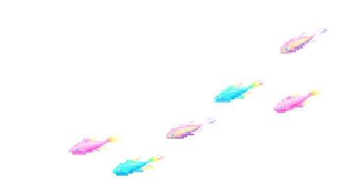

  

  

 
  
<i>❦  𝕬 𝖋𝖗𝖆𝖌𝖒𝖊𝖓𝖙 𝖔𝖋 𝖆 𝖋𝖔𝖗𝖌𝖔𝖙𝖙𝖊𝖓 𝖒𝖊𝖒𝖔𝖗𝖞.   ❦</i>

  EST. UNKNOWN · ORIGIN UNVERIFIED · RECORD INCOMPLETE
  
   𝔄 𝔠𝔬𝔯𝔯𝔢𝔰𝔭𝔬𝔫𝔡𝔢𝔫𝔠𝔢 𝔯𝔢𝔠𝔬𝔳𝔢𝔯𝔢𝔡 𝔣𝔯𝔬𝔪 𝔞𝔫 𝔲𝔫𝔪𝔞𝔯𝔨𝔢𝔡 𝔞𝔯𝔠𝔥𝔦𝔳𝔢. 

*some things are meant to be found, not explained.*

`identity: undisclosed` · `signal: faint` · `presence: unknown`

⌁ classified identity // 001

 

`[ transmission received ]`

▸ classified file // 002

behind the static, something softer survives.

`[ archive unlocked ]`

`[ encrypted fragment ]`

`01001100 01001111 01010110 01000101`

⌁ anomalous transmission // 003

 

`[ WARNING: UNEXPECTED CHAOS DETECTED ]`

`[ SIGNAL DISRUPTED ]`

  

